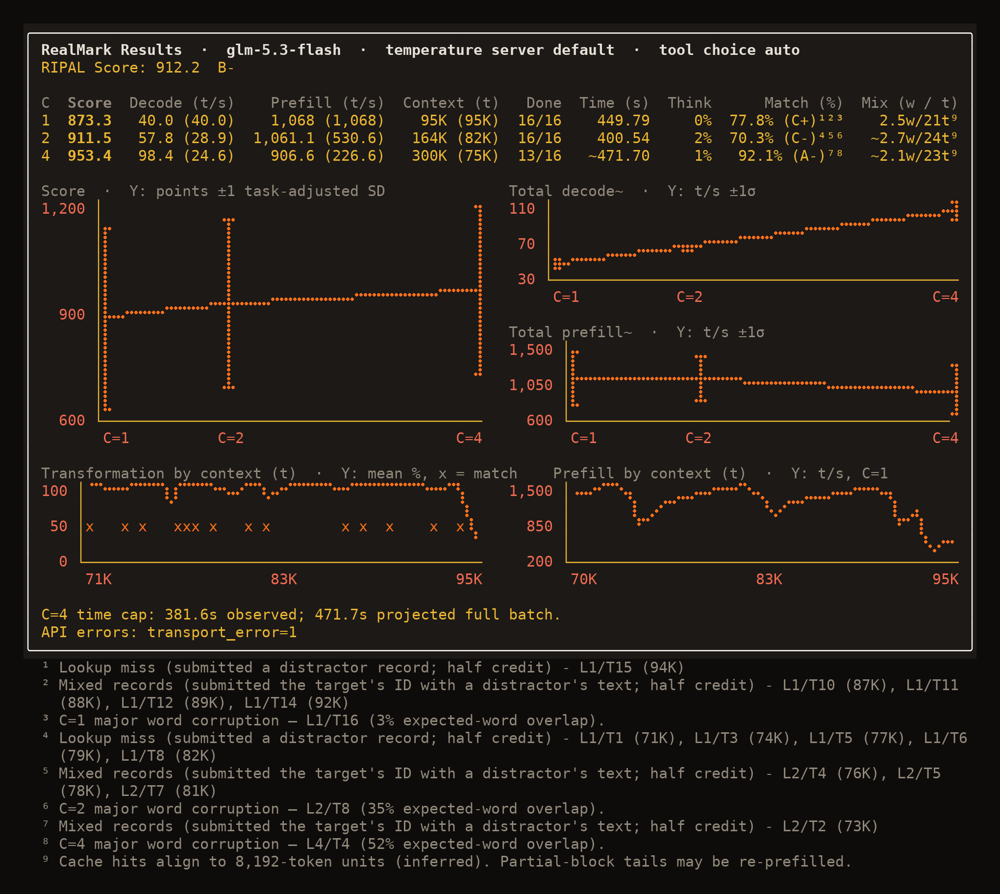

# Realmark

Realmark gives you a RIPAL (Reasoning Independent Pseudo Agentic Load) score for LLM models based
on their performance running reasoning-independent interactive tasks.

This performance is based on the model's agentic interactivity and gives you an idea of how "good"
a model is to work with.



This card comes from [examples/realmark-glm-5.3-flash.json](examples/realmark-glm-5.3-flash.json).
To render it again in a terminal:

```bash
python3 ripal.py --render examples/realmark-glm-5.3-flash.json
```

## RIPAL Tests

The RIPAL tests are reasoning-independent, which means they do not measure an agent's general intelligence,
only its ability to perform basic non-copying transformations and "needle-like" lookups. This does
not count 

**NOTE**: Realmark runs in your server's default thinking mode and in some cases, this default thinking
mode may be excessive for simpler tasks. Setting a forced tool choice, or `low`, `none` or `0` for thinking level may
help if the model overthinks these tasks.

Tasks include:

 - Letter transposition (like "pig latin")
 - Word reversing
 - Vowel removal (`aeiou`), and
 - Case inversion (e.g. `Hello` -> `hELLO`)

### A Note on Tests

"_Pig Latin??_ that's not something I use in my coding agent!"

That's true. Realmark is designed to be reasoning independent and tests the quality of your models'
weight and quantization. There are many benchmarks designed to test coding ability and completion of
reasoning-dependent tests. Realmark focuses on the important basics: agentic ability to manipulate
tokens at a _word level_ (which is surprisingly difficult - see the _how many r's in strawberry_ test)
and its baseline turnaround timing for interactive turns.

## RIPAL Score

RIPAL scores are calibrated so a model with a score of 1,000 can complete most interactive agentic
tasks, including those with large tool calls, in a reasonable amount of time. This is based on somewhat
subjective experience. RIPAL scores are also not linear- a model that prefills 2x as fast will not receive
a doubled score.

Note that RIPAL scores are not based on tokens as tokenization varies between models. Instead, RIPAL uses words,
and tasks based around transformations of whole words. Tasks are calibrated against the input and output word/token
counts of real agentic work streams. 

The score is defined as:

$$
S_C = 1000 \cdot \frac{\sinh^{-1}\left(\dfrac{W_C}{10\,(T_C - \frac{1}{2}\Theta_C)}\right)}{\sinh^{-1}(1)}
$$

where

- $W_C$ is the weighted visible output words all lanes' finished tasks (each punctuation mark or symbol counts as $0.25$),
  across reply text and tool-call arguments. Thinking is excluded.
- $T_C$ is the wall-clock time in seconds, from the start of non-warmup work until the last lane finishes.
- $\Theta_C$ is the wall-clock time spent thinking: for each request, the seconds from its first reasoning output to
  its first visible output, summed over all lanes and divided by $C$. Thinking time counts at half weight, so a
  model that thinks longer still scores lower, but not one for one.

By default, RIPAL measures four levels of concurrency (C=1, 2 and 4), but this can be overridden on
the command-line.

The headline score is the geometric mean over the concurrency levels $\mathcal{C}$ (by default $\{1, 2, 4\}$):

$$
S = \left( \prod_{C \in \mathcal{C}} S_C \right)^{1/|\mathcal{C}|}
$$

### A Note on Thinking

The prompts ask the model not to think, but some models require a minimum
amount of thinking to return correct answers. If the model does end up thinking to answer, the thinking time
is penalized half as much as generation time - the penalty is designed to factor in thinking time without
putting all non-thinking models above all thinking models. $0.5$ was effectively picked as the half-way compromise between
"thinking should not be penalized" and "thinking should be fully penalized"

### Prefill Fit

A request that adds a few hundred tokens to a long cached history spends most of its prefill time on what the server
does for any request, so fresh tokens over prefill time can read far below the server's real prefill rate. The card
fits every C=1 request, warmup and measured (one lane, so no queueing), to the seconds each further fresh token
costs, as a rate, and the seconds a request pays at any size.

A queue or a busy server delays a request whatever its size, and on a shared endpoint most requests can wait. A delay
only adds time, so the fit takes the low edge of the points: the line with 10% of requests below it, with the fixed
cost held at zero or above. Each request's time above that line is its wait, and the card reports the median. The
fixed cost's 95% interval comes from 100 seeded resamples. The card shows the fit when under 5% of resamples put the
per-token cost at zero.

Measured tasks add similar amounts of fresh input, too narrow a range to separate the two costs on a fast server. So
the warmup tasks after the first are prefill probes: each adds distractor records to its file, full-size records of
the same shape with their own IDs, in sizes that grow 4x a step, from half the seeded history's word budget. The file
is shuffled, so the target can sit anywhere in it. Measured tasks keep the seeds they had after v16's 2 plain warmup
tasks, whatever --warmup-tasks is set to. The history gives up the weighted words the larger warmup adds, to the
nearest whole history task, so measured tasks run at about the same context as in v16 and a server scores the same.
With 4 warmup tasks (the default) and a 40,000-word history, the probes add about 4, 15 and 60 records (950, 3,800
and 15,200 words). The records are drawn fresh each attempt, so no earlier attempt or run's prefix cache holds them.

A server that delays many requests can delay the probes too. So at C=1, warmup ends after its first attempt only when
every request in it sits near one fixed + per-token line (R² at least 0.95, none more than 20% or 0.3 s above it).
Otherwise the lane starts warmup again from a fresh conversation, up to 3 attempts, or until each probe's two fastest
attempts are within 15% or 0.3 s of each other. Every attempt's requests go into the fit, so another attempt can make
up for a delayed probe. The measured run continues from the last attempt, so its context does not change. A warmup
reply that reaches max_tokens fails its task, and warmup goes on, since warmup falls outside scored time.

One request past its response deadline fails its task, and the run goes on. So does one measured reply that runs on
to max_tokens without thinking. A second of either in the same level stops the run, and so does a reply that reaches
max_tokens while thinking, since a model that thinks past its budget will keep doing it.

The Fixed (s) column is each level's fixed cost: the fit's, or that level's median (prefill seconds less fresh tokens at
the fit's rate) where that is smaller, since some servers spend less a request under load. The prefill column and the
prefill charts leave it out. Without a fit, the column shows a dash and the prefill rates include it.

## Quality Score

Each run also gets a quality score as a letter grade. While the tasks are reasoning-independent, model and quantization quality
tends to be inversely proportional to the final score. Stronger models tend to be able to perform multi-token tasks with
greater ease, and make fewer mistakes. The quality score also measures the model's ability to locate specific content
in larger toolcall responses, which similarly tracks the quality of an engine's KV implementation and its quantization.


